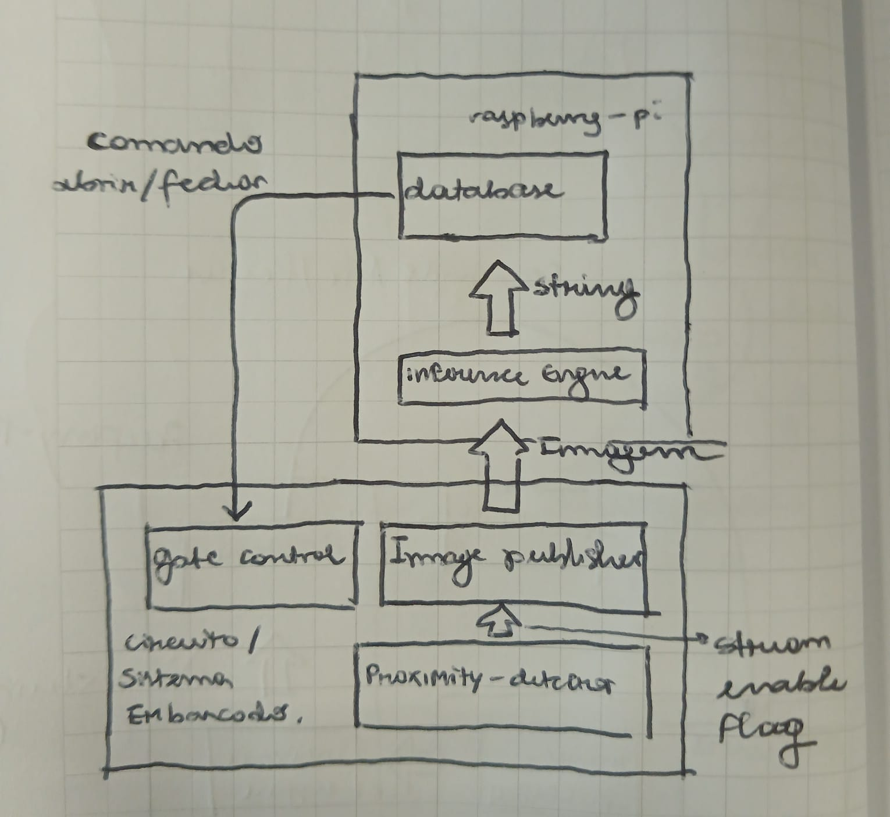
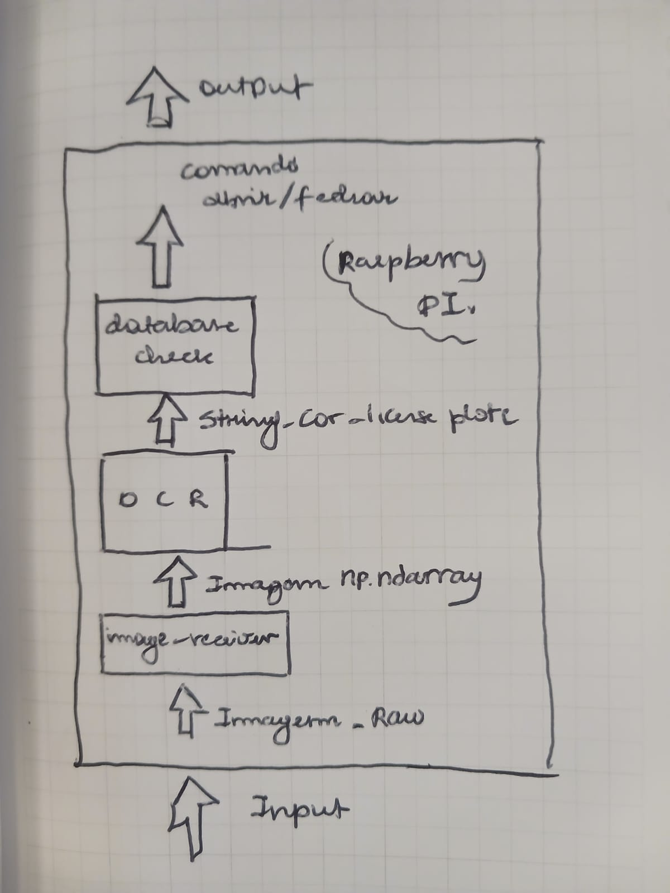

# IA embarcada Gandalf

Sistema embarcado para identificação automática de veículos e controle de acesso por placa.

## Visão geral

O Gandalf tem como objetivo controlar a abertura de um portão sem intervenção manual. Quando os sensores detectam a aproximação de um veículo, uma câmera publica uma imagem para o Raspberry Pi. O sistema processa essa imagem, identifica a placa por OCR e consulta uma base de dados de placas autorizadas. A decisão resultante é enviada ao circuito de controle do portão:

- placa cadastrada: o portão pode ser aberto;
- placa não cadastrada ou leitura inválida: o portão permanece fechado.

A arquitetura prevista separa a aquisição de sinais e imagens, executada no ESP32-CAM, do processamento e da decisão, executados no Raspberry Pi.

## Fluxo do sistema

1. Os sensores de proximidade detectam um objeto e o sistema confirma a presença de um veículo.
2. O ESP32-CAM captura e publica os dados da imagem.
3. O Raspberry Pi recebe a imagem e encaminha o conteúdo ao mecanismo de detecção.
4. O OCR localiza a placa e converte sua imagem em uma string.
5. A placa reconhecida é armazenada e comparada com a base de dados.
6. O Raspberry Pi envia o comando de abrir ou manter fechado ao circuito do portão.

O requisito de detecção está descrito em [requirements/DetectSign.feature](requirements/DetectSign.feature). A comunicação entre os componentes ainda deve ser definida e implementada.

## Diagramas

Visão geral do sistema:



Fluxo interno do Raspberry Pi:



## Estrutura do repositório

```text
.
├── requirements/
│   ├── DetectSign.feature       # Requisito de detecção e transcrição da placa
│   └── README.md
├── src/
│   ├── esp32_src/               # Código previsto para o ESP32-CAM
│   │   └── README.md
│   ├── raspberry-pi_src/        # Código previsto para o Raspberry Pi
│   │   ├── main.py              # Orquestração da aplicação
│   │   ├── databaseCheck/       # Consulta de placas autorizadas
│   │   ├── imageReceiver/       # Recepção das imagens
│   │   ├── OCR/                 # Reconhecimento da placa
│   │   └── README.md
│   └── README.md
├── system_diagrams/             # Diagramas da arquitetura
├── tests/
│   ├── esp32_src/               # Testes do código do ESP32-CAM
│   ├── raspberry-pi_src/        # Testes do código do Raspberry Pi
│   └── README.md
├── LICENSE
└── README.md
```

Os arquivos de código e READMEs dos módulos ainda estão em fase inicial. A estrutura acima representa as responsabilidades planejadas para cada componente.

## Componentes

### ESP32-CAM

Responsável pela captura da imagem do veículo e pela publicação dos dados para o Raspberry Pi. Também deve integrar os sensores ou receber o sinal de detecção do circuito embarcado, conforme a implementação final do hardware.

### Raspberry Pi

Responsável pelo fluxo de processamento da imagem e pela decisão de acesso. Seus módulos previstos são:

- `imageReceiver`: recebe a imagem bruta publicada pelo ESP32-CAM;
- `OCR`: detecta a região da placa e produz o texto reconhecido;
- `databaseCheck`: verifica se a placa está autorizada;
- `main.py`: coordena a recepção, o reconhecimento, a consulta e o comando do portão.

### Circuito de controle do portão

Recebe o comando de saída do Raspberry Pi e aciona o mecanismo físico de abertura quando a placa for validada. O comportamento elétrico e o protocolo de comunicação ainda precisam ser especificados.

## Desenvolvimento e testes

O projeto está organizado por responsabilidade, com requisitos em Gherkin, código separado por plataforma e diretórios reservados para testes. Antes da integração física, recomenda-se validar cada etapa isoladamente:

1. recepção de uma imagem de teste;
2. reconhecimento de placas em diferentes condições;
3. consulta para placas autorizadas e não autorizadas;
4. emissão do comando de abertura;
5. fluxo completo com ESP32-CAM, Raspberry Pi e circuito do portão.

Os comandos de instalação, execução e teste serão adicionados quando as dependências e o protocolo de comunicação forem definidos.

## Cronograma

Esta seção será usada para registrar o cronograma do projeto. As datas podem ser preenchidas após a definição da equipe, dos componentes e dos marcos de integração.

| Etapa | Entregável | Responsável | Prazo | Status |
| --- | --- | --- | --- | --- |
| Definição de requisitos | Requisitos funcionais e critérios de aceitação | A definir | A definir | Não iniciado |
| Integração dos sensores | Detecção de veículo pelo circuito embarcado | A definir | A definir | Não iniciado |
| Captura e comunicação | ESP32-CAM publicando imagens | A definir | A definir | Não iniciado |
| Recepção no Raspberry Pi | Módulo `imageReceiver` funcional | A definir | A definir | Não iniciado |
| OCR | Placa convertida em texto | A definir | A definir | Não iniciado |
| Banco de dados | Consulta de placas autorizadas | A definir | A definir | Não iniciado |
| Controle do portão | Comando de abrir ou manter fechado | A definir | A definir | Não iniciado |
| Integração e testes | Validação do fluxo completo | A definir | A definir | Não iniciado |

## Licença

Consulte o arquivo [LICENSE](LICENSE) para os termos de uso do projeto.
