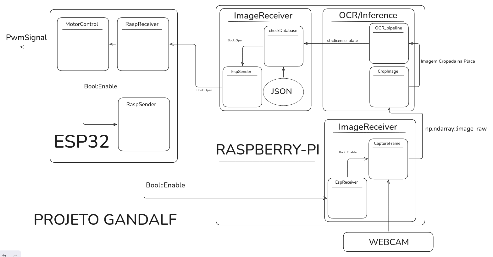

# Projeto Gandalf

Sistema embarcado de controle de acesso por identificação automática de placas.

## Objetivo

O Gandalf combina um ESP32 e um Raspberry Pi para decidir se um veículo pode
acionar um portão. O ESP32 concentra a interação com os sensores e os sinais
elétricos; o Raspberry Pi recebe a imagem, executa a inferência/OCR, consulta
as placas autorizadas e devolve a decisão ao controlador.

O diagrama de referência é:



Ele representa os módulos, as conexões entre ESP32 e Raspberry Pi e os
contratos de dados que devem orientar a integração.

## Fluxo ponta a ponta

1. `MotorControl` recebe `PwmSignal` e habilita o acionamento do ESP32.
2. `RaspReceiver` recebe esse estado e `RaspSender` publica a habilitação para
   o Raspberry Pi.
3. No Raspberry Pi, `EspReceiver` habilita `CaptureFrame`, que captura a
   imagem da webcam.
4. `ImageReceiver` entrega a imagem bruta como `np.ndarray::image_raw`.
5. `CropImage` localiza e recorta a placa. `OCR_pipeline` transforma o recorte
   em `str::license_plate`.
6. `checkDatabase` consulta a placa e produz a decisão de autorização.
7. A decisão volta pelo canal de controle para `MotorControl`, que gera o
   `PwmSignal` do portão.

O JSON do canal entre `ImageReceiver`/`EspSender` e `checkDatabase` ainda
precisa ter um esquema formal. Os nomes acima são os nomes lógicos do
diagrama; alguns ainda não possuem implementação no repositório.

## Estado atual da implementação

| Módulo do diagrama | Implementação atual |
| --- | --- |
| `MotorControl`, `RaspReceiver`, `RaspSender` | Ainda não implementados em `src/esp32_src`. |
| `EspReceiver`, `CaptureFrame` | Ainda não existem como classes separadas. |
| `ImageReceiver` | Implementado com `cv2.VideoCapture`; hoje lê uma câmera local. |
| `CropImage` | Implementado como `CropLicensePlate` em `OCR/LPRegionCrop.py`, usando YOLO e `best.pt`. |
| `OCR_pipeline` | Implementado em `OCR/OCR.py` com EasyOCR em CPU. |
| `checkDatabase` | Diretório criado, mas `databaseCheck.py` ainda não contém lógica. |
| `JSON`, `np.ndarray::image_raw`, `str::license_plate` | Contratos representados no diagrama, sem protocolo validado no código. |

Portanto, a execução atual cobre apenas a captura local e parte do pipeline de
OCR. A integração ESP32--Raspberry Pi, a persistência/consulta da base e o
comando físico do portão continuam pendentes.

## Organização do repositório

```text
.
├── requirements/                 # Cenários funcionais em Gherkin
├── src/
│   ├── esp32_src/               # MotorControl, RaspReceiver e RaspSender
│   └── raspberry-pi_src/
│       ├── imageReceiver/       # ImageReceiver e futura entrada do ESP32
│       ├── OCR/                 # CropImage e OCR_pipeline
│       ├── databaseCheck/       # checkDatabase
│       └── main.py              # Orquestração do fluxo no Raspberry Pi
├── system_diagrams/             # Diagramas de arquitetura
├── tests/                       # Testes e ferramentas de validação
└── LICENSE
```

## Como rodar
 
### 1. Pré-requisitos
 
- Python 3.10 ou superior
- Git
- Uma webcam
- Uma tela/ambiente gráfico 

### 2. Clonar o repositório
 
```bash
git clone https://github.com/Liga-Academica-de-Sistemas-Embarcados/IA_embarcada_Gandalf.git
cd IA_embarcada_Gandalf
```
 
### 3. Dependências
 
Instale as dependências rodando:
 
```bash
pip install -r requirements.txt
```
 
> A primeira execução do EasyOCR baixa os modelos de reconhecimento
> (precisa de internet). O PyTorch é grande; a instalação pode demorar.
 
> **Erro de `cv2.imshow` / "The function is not implemented"?** O `easyocr`
> pode instalar o `opencv-python-headless`, que não tem interface gráfica.
> Corrija com:
> ```bash
> pip uninstall -y opencv-python opencv-python-headless
> pip install opencv-python
> ```
 
### 4. Executar os testes automatizados (base de placas)
 
A partir da raiz do repositório:
 
```bash
python -m unittest tests/raspberry-pi_src/test_databaseCheck.py
```
 
Saída esperada: `Ran 4 tests ... OK`. Não precisa de câmera nem de GPU.
 
Para alterar as placas autorizadas, edite
`src/raspberry-pi_src/databaseCheck/plates.json` (lista JSON de strings; a
comparação ignora espaços e maiúsculas/minúsculas).
 
### 5. Executar o pipeline com a webcam (OCR em loop)
 
```bash
cd tests/raspberry-pi_src/OCR
python testWebcamIntegration.py
```
 
O script abre a câmera de índice `0`, roda detecção + OCR continuamente e
imprime `placa detectada: <texto>` (ou `None` quando não há placa/texto
confiável). Pare com `Ctrl+C`. Se a câmera não abrir, o script encerra com
`[ERROR]: FATAL: câmera não abriu!!!`; teste outro índice alterando
`RPI_CAM_INDEX`.
 
### 6. Executar o modelo em uma imagem
 
```bash
cd tests/raspberry-pi_src/OCR
python testModelOnImage.py --image /caminho/para/foto_da_placa.jpg
```
 
Mostra o recorte da placa detectada numa janela (feche com qualquer tecla) e
imprime a confiança da detecção.

## Licença

Consulte [LICENSE](LICENSE).
